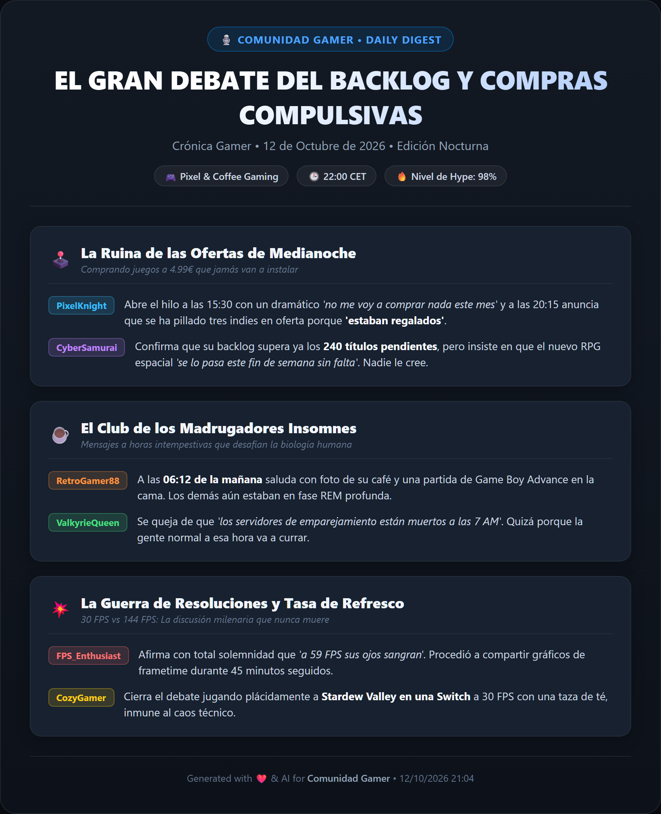

[🇬🇧 English](README.md) | [🇪🇸 Español](README_ES.md)

# 🚀 Telegram AI Daily Summary Bot & Infographic Generator

[](https://www.python.org/)
[](https://github.com/solari21/telegram-ai-summary-template/releases/tag/v0.2.0)
[](https://github.com/features/actions)
[](https://aistudio.google.com/)
[](https://docs.telethon.dev/)
[](https://playwright.dev/)
[](LICENSE)

> **Transform active Telegram communities and gaming groups into a visually stunning, witty AI infographic digest. Available both as an automated Serverless Template and as an installable Python CLI Package.**

---

## 📸 Demo Preview

Here is an example of the high-resolution infographic card automatically rendered by this bot:

<p align="center">
  
</p>

---

## ✨ Features

- ⚡ **100% Serverless & Free**: Runs on scheduled GitHub Actions crons. Requires zero VPS, zero hosting costs, and zero servers running 24/7.
- 📅 **Triple Execution Modes**:
  1. **Slot Summaries**: Morning (07:00), Midday (14:30), and Evening (22:00) with slot-tailored subtitles and horizons.
  2. **Full Day Digest**: Automated midnight recap covering the entire 24h day (00:00 to 23:59).
  3. **On-Demand Manual Runs**: Launch anytime directly from GitHub Actions with custom hours (e.g. 2, 4, 8, 12, 24, 48) and custom card headlines.
- 🧠 **Resilient 5-Model AI Cascade & Exponential Backoff**: Built for cutting-edge **Google Gemini 3.8 Flash**, with automated retries (3s / 6s backoff) and fault-tolerant fallbacks to **3.5 Flash**, **3.5 Flash Lite**, **2.0 Flash**, and **2.0 Flash Lite** to withstand Google server spikes (503 / 500 / 429).
- 🎨 **Retina-Grade Dark-Mode Cards**: Custom Jinja2 HTML5/CSS3 template rendered with headless Chromium via Playwright at 2x device scale for razor-sharp typography and vibrant badges.
- 🔐 **Zero-Leak Architecture**: Uses Telethon `StringSession` and GitHub Actions encrypted secrets. No SQLite session files stored on disk.
- 🕒 **Smart Timezone & Slot Detection**: Automatically calculates inspection windows and converts all message timestamps to your local timezone (e.g. `Europe/Madrid`).
- 🛠️ **Public-Ready Template**: No private tokens, chat IDs, or personal messages are hardcoded. Ready to fork, customize, and deploy in under 5 minutes.

---

## 🏛️ Architecture & Workflow

<p align="center">
  <picture>
    <source media="(prefers-color-scheme: dark)" srcset="assets/architecture-dark.svg">
    <source media="(prefers-color-scheme: light)" srcset="assets/architecture-light.svg">
    
  </picture>
</p>

---

## 📅 GitHub Actions Automation Modes

The template includes **3 ready-to-use workflows**:

### 1. Slot Summaries (`daily_summary.yml`)
Runs automatically 3 times daily using off-peak minutes (`:02` and `:32`) to prevent GitHub Actions top-of-the-hour queue drops:
* **07:00 Local** (05:02 UTC in summer): Inspects the fixed window **22:00 (yesterday) to 07:00 (today)**.
* **14:30 Local** (12:32 UTC in summer): Inspects the fixed window **07:00 to 14:30 (today)**.
* **22:00 Local** (20:02 UTC in summer): Inspects the fixed window **14:30 to 22:00 (today)**.
* *Queue Delay Decoupling*: Because inspection horizons are defined by fixed clock windows in your local timezone (`TIMEZONE`), even if a runner spends 2+ hours in a GitHub Actions queue, the summary content, timestamps, and badges remain **100% accurate and mathematically congruent**, never shifting into the next slot.

### 2. Full Day Digest (`full_day_summary.yml`)
* **23:59 Local** (21:58 UTC in summer): Runs at midnight to collect and digest all messages from **00:00:00 to 23:59:59**.
* *Midnight Boundary Resilience*: If the runner is delayed past 00:00 (or if triggered manually during early morning hours 00:00 - 05:59), the engine automatically targets **yesterday's full calendar day** (00:00:00 to 23:59:59), guaranteeing 100% complete day summaries without empty outputs.

### 3. Manual Digest on Demand (`manual_summary.yml`)
Dispatched manually via GitHub Actions or API webhook with interactive inputs:
* **`hours_back`**: Number of hours to inspect (default: `8`).
* **`custom_title`**: Optional custom banner headline for the card.

---

## ☁️ 100% Cloud Automation (Zero Queue Delays with `cron-job.org`)

GitHub Actions' built-in scheduled crons run on shared community queues that can sometimes experience latency (from 10 minutes up to 2 hours during peak periods).

To achieve **second-level punctuality** completely free without running any local machine:
1. Create a free account at [cron-job.org](https://cron-job.org).
2. Create 4 cron jobs targeting GitHub's `dispatches` endpoint:
   - **URL**: `https://api.github.com/repos/<YOUR_GITHUB_USERNAME>/<YOUR_FORKED_REPO>/dispatches`
   - **Method**: `POST`
   - **Headers**:
     - `Authorization`: `Bearer <YOUR_GITHUB_PAT>` *(needs `repo` or `workflow` scope)*
     - `Accept`: `application/vnd.github+json`
     - `Content-Type`: `application/json`
3. **Payloads & Schedules**:
   - **Morning (07:00 Local)**: `{"event_type": "morning_summary", "client_payload": {"slot": "morning"}}`
   - **Midday (14:30 Local)**: `{"event_type": "midday_summary", "client_payload": {"slot": "midday"}}`
   - **Evening (22:00 Local)**: `{"event_type": "evening_summary", "client_payload": {"slot": "evening"}}`
   - **Full Day (23:58 Local)**: `{"event_type": "full_day_summary"}`

*GitHub Actions starts the container within 10 seconds of receiving the webhook call, delivering your infographic to Telegram on the exact second!*

---

## ⚡ Instant Dispatch from CLI (`tools/trigger_summary.py`)

You can also trigger any workflow instantly from your command line without opening GitHub's web interface:

```bash
# Set your GitHub PAT once:
export GITHUB_TOKEN="ghp_xxxx"
export GITHUB_REPOSITORY="your-user/your-repo"

# Trigger midday edition:
python tools/trigger_summary.py --slot midday

# Trigger full 24h day digest:
python tools/trigger_summary.py --full-day

# Trigger manual on-demand run with custom title:
python tools/trigger_summary.py --hours 6 --custom-title "WEEKEND TOURNAMENT"
```

> [!TIP]
> **Template-Safe Scheduled Crons**: The automated workflows include a built-in safety condition: scheduled cron runs only execute when `TELEGRAM_STRING_SESSION` and `GEMINI_API_KEY` secrets are configured. This prevents noisy failed run notifications on the upstream public template while activating seamlessly the moment you fork the repo and add your secrets!

---

## 🕹️ How to Trigger a Manual Digest from GitHub Web

1. Navigate to the **Actions** tab in your repository.
2. Under **Workflows** on the left sidebar:
   * Select **Telegram AI - Slot Summaries** ➔ click **Run workflow** (choose `midday`, `morning`, `evening`, or `auto`).
   * Select **Telegram AI - Manual Digest on Demand** ➔ click **Run workflow** (enter hours and custom title).
   * Select **Telegram AI - Full Day Digest** ➔ click **Run workflow**.
3. The job completes in ~40 seconds and dispatches the infographic directly to Telegram!

---

## 📦 Quick Installation as a Python Package / CLI

You can install and use `telegram-ai-summary` directly in any environment via `pip`:

```bash
# 1. Install directly via pip (Precompiled Wheel from Releases):
pip install https://github.com/solari21/telegram-ai-summary-template/releases/download/v0.2.0/telegram_ai_summary-0.2.0-py3-none-any.whl

# Or install from main branch source:
pip install git+https://github.com/solari21/telegram-ai-summary-template.git

# 2. Install Playwright browser dependencies:
playwright install chromium

# 3. Generate your Telegram session string:
telegram-ai-summary session

# 4. Generate a sample offline preview infographic:
telegram-ai-summary demo

# 5. Run the live digest pipeline:
telegram-ai-summary run --hours 8

# 6. Run full-day digest:
telegram-ai-summary run --full-day

# 7. Run manual digest with custom headline:
telegram-ai-summary run --hours 12 --custom-title "EVENING REPORT"
```

---

## ⚡ 5-Minute Quick Start Guide (GitHub Actions Serverless)

### Step 1: Fork This Repository
Click the **Fork** button at the top right of this page.

### Step 2: Get Your Telegram API Credentials
1. Log into [my.telegram.org](https://my.telegram.org) with your phone number.
2. Go to **API development tools**.
3. Create a new application and copy `api_id` and `api_hash`.

### Step 3: Generate Your Telegram `StringSession`
```bash
git clone https://github.com/YOUR_USERNAME/telegram-ai-summary-template.git
cd telegram-ai-summary-template
pip install -r requirements.txt
python tools/generate_string_session.py
```
Enter credentials and copy the generated `TELEGRAM_STRING_SESSION`.

### Step 4: Get a Free Google Gemini API Key
1. Go to [Google AI Studio](https://aistudio.google.com/).
2. Create an API key (`AIzaSy...`).

### Step 5: Configure GitHub Secrets
In your forked repo: **Settings** ➔ **Secrets and variables** ➔ **Actions** ➔ **New repository secret**:

| Secret Name | Description | Example |
|---|---|---|
| `TELEGRAM_API_ID` | Numeric API ID from my.telegram.org | `12345678` |
| `TELEGRAM_API_HASH` | 32-character API Hash | `0123456789abcdef...` |
| `TELEGRAM_STRING_SESSION` | Generated string session token | `1BVtsOHQBu4...` |
| `TELEGRAM_CHAT_ID` | Target Telegram group ID | `-1001234567890` |
| `GEMINI_API_KEY` | API Key from Google AI Studio | `AIzaSy...` |
| `TELEGRAM_SEND_TO` *(Optional)* | Recipient chat | `me` (Saved Messages) |

---

## 📁 Repository Structure

```
.
├── .github/
│   └── workflows/
│       ├── daily_summary.yml      # Automated slot digests (07:00, 14:30, 22:00)
│       ├── full_day_summary.yml   # Automated full-day recap (23:59 / 00:00-23:59)
│       ├── manual_summary.yml     # On-demand manual digest with custom parameters
│       └── publish_package.yml    # PyPI / GitHub Packages automated release
├── assets/
│   ├── architecture-dark.png      # Retina @2x architecture diagram (dark)
│   ├── architecture-dark.svg      # Standalone vector architecture (dark)
│   ├── architecture-light.png     # Retina @2x architecture diagram (light)
│   ├── architecture-light.svg     # Standalone vector architecture (light)
│   ├── architecture.svg           # Universal architecture SVG
│   └── demo_summary.png           # Showcase infographic sample image
├── output/                        # Local output folder (git-ignored)
├── src/
│   └── telegram_ai_summary/
│       ├── card_renderer.py       # Playwright + Jinja2 HTML-to-PNG renderer
│       ├── cli.py                 # Multi-mode CLI entry point (--hours, --full-day)
│       ├── config.py              # Robust environment configuration and parsers
│       ├── mock_data.py           # Sample preview data
│       ├── summary_generator.py   # Gemini API client with 5-model cascade & backoff
│       ├── telegram_fetcher.py    # MTProto message ingestion (slot and full-day)
│       └── telegram_sender.py     # MTProto photo sender with markdown captions
├── templates/
│   └── card_template.html         # Responsive dark-mode infographic card template
├── tools/
│   ├── generate_string_session.py # Interactive CLI tool to generate StringSession
│   ├── render_demo.py             # Offline mock card generator for demos
│   ├── setup_windows_scheduler.ps1 # Optional Windows Task Scheduler registration
│   └── trigger_summary.py         # Instant CLI trigger via GitHub REST API
├── .env.example                   # Environment variable template
├── .gitignore                     # Git ignore rules protecting all credentials
├── LICENSE                        # MIT License
├── main.py                        # Central bot orchestrator
├── pyproject.toml                 # Modern PEP 621 Python packaging config
├── requirements.txt               # Lightweight Python dependencies
└── TODO.md                        # Living roadmap & completed milestones
```

---

## 📋 Project Status & Roadmap (TODO)

For a complete checklist of implemented production milestones and upcoming planned enhancements, check out:
👉 **[TODO.md](TODO.md)**

---

## 📄 License

This project is licensed under the [MIT License](LICENSE) © 2026 Jesús Moronta ([@solari21](https://github.com/solari21)).

