# 🚀 Telegram AI Daily Summary Bot & Infographic Generator

[](https://www.python.org/)
[](https://github.com/solari21/telegram-ai-summary-template)
[](https://github.com/features/actions)
[](https://aistudio.google.com/)
[](https://docs.telethon.dev/)
[](https://playwright.dev/)
[](LICENSE)

> **Transform active Telegram communities and gaming groups into a visually stunning, witty AI infographic digest. Available both as an automated Serverless Template and as an installable Python CLI Package.**

---

## 📸 Demo Preview

Here is an example of the high-resolution infographic card automatically rendered by this bot:

<p align="center">
  
</p>

---

## ✨ Features

- ⚡ **100% Serverless & Free**: Runs on scheduled GitHub Actions crons. Requires zero VPS, zero hosting costs, and zero servers running 24/7.
- 📅 **Triple Execution Modes**:
  1. **Slot Summaries**: Morning (07:00), Midday (14:30), and Evening (22:00) with slot-tailored subtitles and horizons.
  2. **Full Day Digest**: Automated midnight recap covering the entire 24h day (00:00 to 23:59).
  3. **On-Demand Manual Runs**: Launch anytime directly from GitHub Actions with custom hours (e.g. 2, 4, 8, 12, 24, 48) and custom card headlines.
- 🧠 **Resilient 4-Model AI Cascade**: Built for cutting-edge **Google Gemini 3.8 Flash**, with an automatic fault-tolerant fallback cascade to **3.5 Flash**, **3.1 Flash Lite**, and **2.5 Flash** if Google experiences temporary peak demand (503) or rate limits.
- 🎨 **Retina-Grade Dark-Mode Cards**: Custom Jinja2 HTML5/CSS3 template rendered with headless Chromium via Playwright at 2x device scale for razor-sharp typography and vibrant badges.
- 🔐 **Zero-Leak Architecture**: Uses Telethon `StringSession` and GitHub Actions encrypted secrets. No SQLite session files stored on disk.
- 🕒 **Smart Timezone & Slot Detection**: Automatically calculates inspection windows and converts all message timestamps to your local timezone (e.g. `Europe/Madrid`).
- 🛠️ **Public-Ready Template**: No private tokens, chat IDs, or personal messages are hardcoded. Ready to fork, customize, and deploy in under 5 minutes.

---

## 🏛️ Architecture & Workflow

```mermaid
flowchart LR
    A["📱 Telegram Group\n(Supergroup)"] -->|"MTProto Client\n(Telethon)"| B["📥 Message Fetcher\n(Slot / 24h / Manual)"]
    B -->|"Chronological Chat"| C["🧠 Gemini AI Engine\n(4-Model Cascade 3.8 ➔ 3.5 ➔ 3.1 ➔ 2.5)"]
    C -->|"Structured JSON Digest"| D["🎨 Template Engine\n(Jinja2 HTML/CSS + Dynamic Subtitles)"]
    D -->|"DOM Snapshot"| E["🌐 Playwright Chromium\n(2x Retina PNG)"]
    E -->|"High-Res Photo"| F["📤 Telegram Sender\n(Saved Messages / Channel)"]

    style A fill:#17212b,stroke:#2b5278,stroke-width:2px,color:#fff
    style C fill:#2b1b3d,stroke:#7c3aed,stroke-width:2px,color:#fff
    style E fill:#0d2818,stroke:#10b981,stroke-width:2px,color:#fff
    style F fill:#1e293b,stroke:#3b82f6,stroke-width:2px,color:#fff
```



---

## 📅 GitHub Actions Automation Modes

The template includes **3 ready-to-use workflows**:

### 1. Slot Summaries (`daily_summary.yml`)
* **07:00 Local** (Morning): Inspects the last 9 hours (overnight activity).
* **14:30 Local** (Midday): Inspects the last 7.5 hours (morning work/study).
* **22:00 Local** (Evening): Inspects the last 7.5 hours (afternoon/prime-time).

### 2. Full Day Digest (`full_day_summary.yml`)
* **23:59 Local**: Runs at midnight to collect and digest all messages from **00:00:00 to 23:59:59** of the current calendar day.

### 3. Manual Digest on Demand (`manual_summary.yml`)
Dispatched manually via GitHub Actions with interactive inputs:
* **`hours_back`**: Number of hours to inspect (default: `8`).
* **`custom_title`**: Optional custom banner headline for the card.

---

## 🕹️ How to Trigger a Manual Digest from GitHub

1. Navigate to the **Actions** tab in your repository.
2. Under **Workflows** on the left sidebar, click **Telegram AI - Manual Digest on Demand**.
3. Click the **Run workflow** button on the right.
4. Fill in the parameters:
   * **Hours to look back**: e.g., `12` or `24`.
   * **Custom headline**: e.g., `WEEKEND GAMING SPECIAL` (optional).
5. Click the green **Run workflow** button.
6. The job completes in ~40 seconds and dispatches the infographic directly to Telegram!

*(You can also click **Run workflow** on «Telegram AI - Full Day Digest» to generate today's full 24h recap at any time).*

---

## 📦 Quick Installation as a Python Package / CLI

You can install and use `telegram-ai-summary` directly in any environment via `pip`:

```bash
# 1. Install directly from GitHub:
pip install git+https://github.com/solari21/telegram-ai-summary-template.git

# 2. Install Playwright browser dependencies:
playwright install chromium

# 3. Generate your Telegram session string:
telegram-ai-summary session

# 4. Generate a sample offline preview infographic:
telegram-ai-summary demo

# 5. Run the live digest pipeline:
telegram-ai-summary run --hours 8

# 6. Run full-day digest:
telegram-ai-summary run --full-day

# 7. Run manual digest with custom headline:
telegram-ai-summary run --hours 12 --custom-title "EVENING REPORT"
```

---

## ⚡ 5-Minute Quick Start Guide (GitHub Actions Serverless)

### Step 1: Fork This Repository
Click the **Fork** button at the top right of this page.

### Step 2: Get Your Telegram API Credentials
1. Log into [my.telegram.org](https://my.telegram.org) with your phone number.
2. Go to **API development tools**.
3. Create a new application and copy `api_id` and `api_hash`.

### Step 3: Generate Your Telegram `StringSession`
```bash
git clone https://github.com/YOUR_USERNAME/telegram-ai-summary-template.git
cd telegram-ai-summary-template
pip install -r requirements.txt
python tools/generate_string_session.py
```
Enter credentials and copy the generated `TELEGRAM_STRING_SESSION`.

### Step 4: Get a Free Google Gemini API Key
1. Go to [Google AI Studio](https://aistudio.google.com/).
2. Create an API key (`AIzaSy...`).

### Step 5: Configure GitHub Secrets
In your forked repo: **Settings** ➔ **Secrets and variables** ➔ **Actions** ➔ **New repository secret**:

| Secret Name | Description | Example |
|---|---|---|
| `TELEGRAM_API_ID` | Numeric API ID from my.telegram.org | `12345678` |
| `TELEGRAM_API_HASH` | 32-character API Hash | `0123456789abcdef...` |
| `TELEGRAM_STRING_SESSION` | Generated string session token | `1BVtsOHQBu4...` |
| `TELEGRAM_CHAT_ID` | Target Telegram group ID | `-1001234567890` |
| `GEMINI_API_KEY` | API Key from Google AI Studio | `AIzaSy...` |
| `TELEGRAM_SEND_TO` *(Optional)* | Recipient chat | `me` (Saved Messages) |

---

## 📁 Repository Structure

```
.
├── .github/
│   └── workflows/
│       ├── daily_summary.yml      # Automated slot digests (07:00, 14:30, 22:00)
│       ├── full_day_summary.yml   # Automated full-day recap (23:59 / 00:00-23:59)
│       ├── manual_summary.yml     # On-demand manual digest with custom parameters
│       └── publish_package.yml    # PyPI / GitHub Packages automated release
├── assets/
│   └── demo_summary.png           # Showcase infographic sample image
├── output/                        # Local output folder (git-ignored)
├── src/
│   └── telegram_ai_summary/
│       ├── card_renderer.py       # Playwright + Jinja2 HTML-to-PNG renderer
│       ├── cli.py                 # Multi-mode CLI entry point (--hours, --full-day)
│       ├── config.py              # Robust environment configuration and parsers
│       ├── mock_data.py           # Sample preview data
│       ├── summary_generator.py   # Gemini API client with 4-model fallback cascade
│       ├── telegram_fetcher.py    # MTProto message ingestion (slot and full-day)
│       └── telegram_sender.py     # MTProto photo sender with markdown captions
├── templates/
│   └── card_template.html         # Responsive dark-mode infographic card template
├── tools/
│   ├── generate_string_session.py # Interactive CLI tool to generate StringSession
│   └── render_demo.py             # Offline mock card generator for demos
├── .env.example                   # Environment variable template
├── .gitignore                     # Git ignore rules protecting all credentials
├── LICENSE                        # MIT License
├── main.py                        # Central bot orchestrator
├── pyproject.toml                 # Modern PEP 621 Python packaging config
└── requirements.txt               # Lightweight Python dependencies
```

---

## 📄 License

This project is licensed under the [MIT License](LICENSE) © 2026 Jesús Moronta ([@solari21](https://github.com/solari21)).
