# 🚀 Telegram AI Daily Summary Bot & Infographic Generator

[](https://www.python.org/)
[](https://github.com/solari21/telegram-ai-summary-template)
[](https://github.com/features/actions)
[](https://aistudio.google.com/)
[](https://docs.telethon.dev/)
[](https://playwright.dev/)
[](LICENSE)

> **Transform active Telegram communities and gaming groups into a visually stunning, witty AI infographic digest. Available both as an automated Serverless Template and as an installable Python CLI Package.**

---

## 📸 Demo Preview

Here is an example of the high-resolution infographic card automatically rendered by this bot:

<p align="center">
  
</p>

---

## ✨ Features

- ⚡ **100% Serverless & Free**: Runs on scheduled GitHub Actions crons. Requires zero VPS, zero hosting costs, and zero servers running 24/7.
- 🧠 **Resilient Multi-Model AI Cascade**: Built for cutting-edge **Google Gemini 3.8 Flash**, with an automatic fault-tolerant fallback cascade to **3.5 Flash**, **3.1 Flash Lite**, and **2.0 Flash** if Google experiences peak demand or rate limits.
- 🎨 **Retina-Grade Dark-Mode Cards**: Custom Jinja2 HTML5/CSS3 template rendered with headless Chromium via Playwright at 2x device scale for razor-sharp typography and vibrant gamer badges.
- 🔐 **Zero-Leak Architecture**: Uses Telethon `StringSession` and GitHub Actions encrypted secrets. No SQLite session files stored on disk.
- 🕒 **Smart Timezone & Slot Detection**: Automatically calculates inspection windows (e.g. morning, midday, and night editions) and converts all message timestamps to your local timezone (e.g. `Europe/Madrid`).
- 🛠️ **Public-Ready Template**: No private tokens, chat IDs, or personal messages are hardcoded. Ready to fork, customize, and deploy in under 5 minutes.

---

## 🏛️ Architecture & Workflow

```mermaid
flowchart LR
    A["📱 Telegram Group\n(Supergroup)"] -->|"MTProto Client\n(Telethon)"| B["📥 Message Fetcher\n(Last N hours)"]
    B -->|"Chronological Chat"| C["🧠 Gemini AI Engine\n(Multi-Model Cascade)"]
    C -->|"Structured JSON Digest"| D["🎨 Template Engine\n(Jinja2 HTML/CSS)"]
    D -->|"DOM Snapshot"| E["🌐 Playwright Chromium\n(2x Retina PNG)"]
    E -->|"High-Res Photo"| F["📤 Telegram Sender\n(Saved Messages / Channel)"]

    style A fill:#17212b,stroke:#2b5278,stroke-width:2px,color:#fff
    style C fill:#2b1b3d,stroke:#7c3aed,stroke-width:2px,color:#fff
    style E fill:#0d2818,stroke:#10b981,stroke-width:2px,color:#fff
    style F fill:#1e293b,stroke:#3b82f6,stroke-width:2px,color:#fff
```



---

## 📦 Quick Installation as a Python Package / CLI

You can install and use `telegram-ai-summary` directly in any environment via `pip`:

```bash
# 1. Install directly from GitHub:
pip install git+https://github.com/solari21/telegram-ai-summary-template.git

# 2. Install Playwright browser dependencies:
playwright install chromium

# 3. Generate your Telegram session string:
telegram-ai-summary session

# 4. Generate a sample offline preview infographic:
telegram-ai-summary demo

# 5. Run the live digest pipeline:
telegram-ai-summary run --hours 8
```

---

## ⚡ 5-Minute Quick Start Guide (GitHub Actions Serverless)

### Step 1: Fork or Clone This Repository

Click the **Fork** button at the top right of this page to create your personal copy of the repository.

### Step 2: Get Your Telegram API Credentials

1. Log into [my.telegram.org](https://my.telegram.org) with your phone number.
2. Go to **API development tools**.
3. Create a new application (name it whatever you like, e.g. `MyDailyDigestBot`).
4. Copy your `api_id` (numeric) and `api_hash` (alphanumeric string).

### Step 3: Generate Your Telegram `StringSession`

Run the included interactive helper tool locally:

```bash
# Clone your fork locally
git clone https://github.com/YOUR_USERNAME/telegram-ai-summary-template.git
cd telegram-ai-summary-template

# Install dependencies
pip install -r requirements.txt

# Run the session generator
python tools/generate_string_session.py
```

Enter your `api_id` and `api_hash` and authenticate with your Telegram login code. The script will print a secure `TELEGRAM_STRING_SESSION`. **Copy it**.

### Step 4: Get a Free Google Gemini API Key

1. Navigate to [Google AI Studio](https://aistudio.google.com/).
2. Click **Get API key** and create a key in your Google account.
3. Copy your API key (starts with `AIzaSy...`).

### Step 5: Configure GitHub Secrets

In your forked GitHub repository, navigate to **Settings** ➔ **Secrets and variables** ➔ **Actions** ➔ **New repository secret**, and add:

| Secret Name | Description | Example / Note |
|---|---|---|
| `TELEGRAM_API_ID` | Numeric API ID from my.telegram.org | `12345678` |
| `TELEGRAM_API_HASH` | 32-character API Hash | `0123456789abcdef...` |
| `TELEGRAM_STRING_SESSION` | Generated string session from Step 3 | `1BVtsOHQBu4...` |
| `TELEGRAM_CHAT_ID` | Target Telegram group ID to read | `-1001234567890` |
| `GEMINI_API_KEY` | API Key from Google AI Studio | `AIzaSy...` |
| `TELEGRAM_SEND_TO` *(Optional)* | Destination recipient | `me` (Saved Messages) or chat ID |

> 💡 **Tip to find your Group Chat ID**: Forward any message from the target group to a bot like `@userinfobot` or `@JsonDumpBot`, or use web Telegram where the URL contains the ID (usually prefixed with `-100`).

### Step 6: Test Your Bot

1. Go to the **Actions** tab in your repository.
2. In the left sidebar, click **Telegram AI Daily Summary Digest**.
3. Click **Run workflow** ➔ Select branch `main` ➔ Click the green button.
4. Watch the runner execute in ~25 seconds and check your Telegram! 🚀

---

## 🛠️ Local Development & Testing

You can also run the generator locally on your computer:

```bash
# 1. Copy the example environment file
cp .env.example .env

# 2. Fill in your credentials in .env
# 3. Install Playwright browser binaries
playwright install chromium

# 4. Run the full pipeline
python main.py

# Or generate a mock demo card without API calls:
python tools/render_demo.py
```

Generated cards will be saved inside the `output/` directory.

---

## 📁 Repository Structure

```
.
├── .github/
│   └── workflows/
│       └── daily_summary.yml      # GitHub Actions automation workflow
├── assets/
│   └── demo_summary.png           # Showcase infographic sample image
├── output/                        # Local output folder (ignored in git)
├── src/
│   ├── config.py                  # Environment config and validation
│   ├── telegram_fetcher.py        # MTProto message ingestion with timezone parsing
│   ├── summary_generator.py       # Gemini API client with multi-model fallback
│   ├── card_renderer.py           # Playwright + Jinja2 HTML-to-PNG renderer
│   └── telegram_sender.py         # MTProto photo sender with markdown captions
├── templates/
│   └── card_template.html         # Responsive dark-mode infographic card template
├── tools/
│   ├── generate_string_session.py # Interactive CLI tool to generate StringSession
│   └── render_demo.py             # Offline mock card generator for demos
├── .env.example                   # Environment variable template
├── .gitignore                     # Git ignore rules protecting all credentials
├── LICENSE                        # MIT License
├── main.py                        # Central bot orchestrator
└── requirements.txt               # Lightweight Python dependencies
```

---

## 🎨 Customization

### Change Schedule
Edit `.github/workflows/daily_summary.yml` and adjust the cron expressions:
```yaml
schedule:
  - cron: '0 5 * * *'    # 07:00 Madrid time
  - cron: '30 12 * * *'  # 14:30 Madrid time
  - cron: '0 20 * * *'   # 22:00 Madrid time
```

### Change Card Style & Theme
Open `templates/card_template.html` to modify CSS variables, accent gradients, font families, or add your community's official logo.

### Change AI Personality & Tone
Open `src/summary_generator.py` and modify `get_system_instruction(community_name)`. You can switch from a humorous gaming chronicler to a formal executive summary, a tech digest, or a crypto market review.

---

## 📄 License

This project is licensed under the [MIT License](LICENSE) © 2026 Jesús Moronta ([@solari21](https://github.com/solari21)).

Feel free to star ⭐ the repository if you find it useful!
